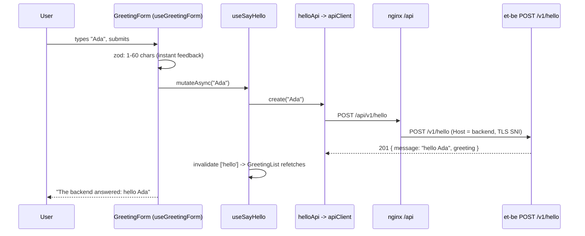

# Hello (full-stack template)

## Overview

The first screen of every project built from the template. On load it shows the **stack status**
(Frontend / Backend API / Database, from the backend's `/ready` probe). The form sends a name to the
backend, which stores it and answers `hello <name>`; the list below re-reads the latest greetings from
the database. If all three status rows say OK and your name appears in the list, the whole chain works.

## Contract

Backend `et-be` (`docs/openapi.json`): `GET /v1/hello` (showHello), `POST /v1/hello` (createHello),
`GET /ready`. Browser calls go to `/api/...`; the Vite dev proxy and nginx strip `/api`.
Error codes handled: `VALIDATION_FAILED` (field error under the input), any other code
(`common:errors.<CODE>` under the form).

## How it works

## Code map

| Layer | Files |
|---|---|
| Page | `src/features/hello/pages/HelloPage/*` |
| Components | `components/GreetingForm/*` (4-file unit), `components/GreetingList/*`, `components/StatusPanel/*` |
| Hooks | `hooks/useHello.ts` (list, readiness), `hooks/useSayHello.ts` (mutation + invalidation) |
| API | `api/helloApi.ts` (transport + types), `api/helloQueries.ts` (keys, queryOptions, mutation) |
| Schema | `greetingSchema.ts` |
| Route | `src/routes/router.tsx` (index route, lazy), `src/routes/paths.ts` (`paths.hello`) |
| i18n | `src/shared/i18n/locales/{en,fr}/hello.json` |

## Configuration

`VITE_API_BASE_URL` (default `/api`), `VITE_BACKEND_UPSTREAM` (dev proxy), `BACKEND_UPSTREAM` (nginx, runtime).

## Testing

`src/features/hello/pages/HelloPage/HelloPage.test.tsx` (status OK/down, submit -> answer + list, client
validation), `greetingSchema.test.ts`, `src/shared/lib/apiClient.test.ts`. Network simulated by MSW in
Node mode (`src/test/handlers/helloHandlers.ts`), so the real apiClient and hooks run.

## Operational notes

The backend mounts the hello routes only with `DEMO_ROUTES=true`. Remove this feature (folder, route,
locale files, handlers) once real features exist.
